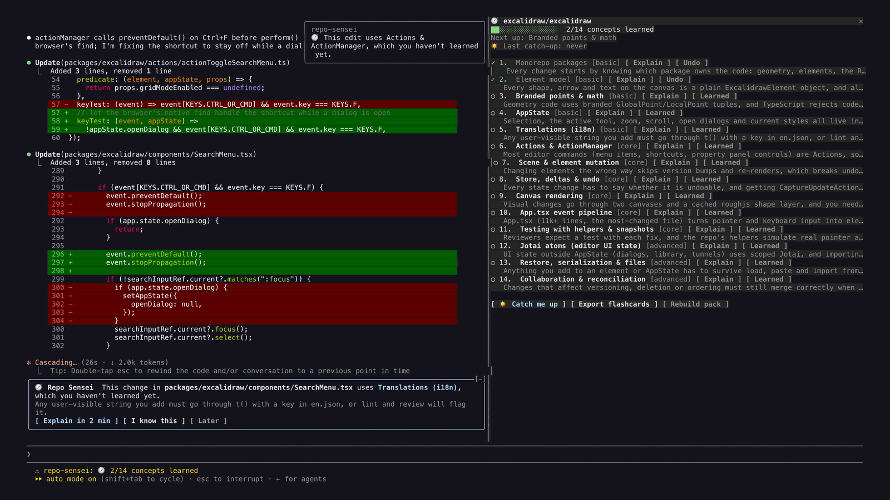
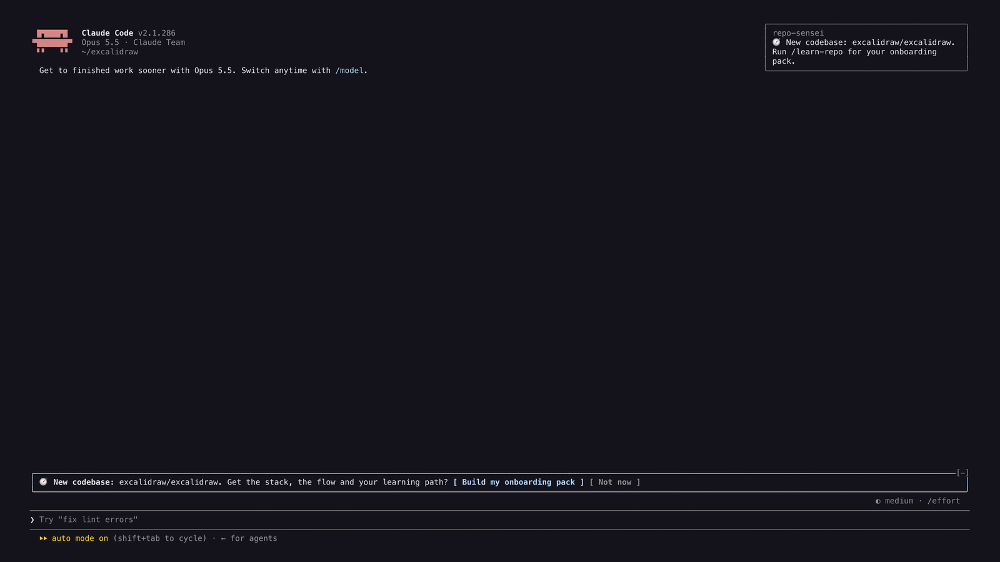
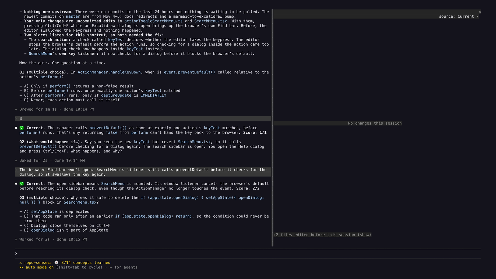

# Repo Sensei 🧭

A Claude Code mod that teaches you any codebase while you contribute to it.



## Install

At the prompt of a Claude Code terminal session:

```
/plugin install repo-sensei --marketplace DhananjaySarathe/repo-sensei
```

Answer `y` to add the marketplace, then pick a scope. From a shell instead:

```bash
claude plugin install repo-sensei --marketplace DhananjaySarathe/repo-sensei
```

Or try it from a clone without installing:

```bash
git clone https://github.com/DhananjaySarathe/repo-sensei ~/repo-sensei
claude --plugin-dir ~/repo-sensei
```

Type `/` and you should see `/learn-repo`, `/sensei`, `/learned`, `/sensei-export` and `/catchup`.

## What it does

- **New repo detected.** Open Claude Code in a git repo it hasn't seen and a band offers to build your onboarding pack.
- **`/learn-repo`** gathers facts (files, manifests, hottest files from git history, contributors, `good first issue`s via `gh`), then has Claude write:
  - `.repo-sensei/ONBOARDING.md`: stack, how the code flows (mermaid diagram), learning path, your first PR, run & test commands, repo glossary
  - `.repo-sensei/concepts.json`: the 8–14 concepts you need, in learning order
- **`/sensei`** opens a panel: progress bar, next concept, Explain / Learned buttons.
- **Live nudges.** When Claude edits code that uses a concept you haven't learned, a band says so, with **Explain in 2 min**, **I know this** or **Later**.
- **`/learned <concept>`** ticks a concept off (`/learned undo <concept>` reverts). Progress is saved per repo, across sessions.
- **`/sensei-export`** writes `flashcards.csv` (Anki import) and `PROGRESS.md`.
- **☀️ Daily catch-up.** Once a day, when something changed in a repo you work in (your commits, teammates' incoming commits, uncommitted work, files Claude edited), a band offers **Catch me up + quiz**. `/catchup` (or `/catchup yesterday | 3d | week`) writes `.repo-sensei/catchup/<date>.md`: TL;DR, what changed and who, files to look at, concepts touched (flags unlearned ones), a 5-minute lesson on the biggest change, and a 5-question quiz. Claude then quizzes you in the chat and scores you. Works in any git repo, with or without an onboarding pack.

| New codebase | Daily catch-up quiz |
|---|---|
|  |  |

## Tips

- Install the GitHub CLI (`gh`) and sign in to get good first issues fetched automatically.
- Add `.repo-sensei/` to your `.gitignore` if you don't want it in your PRs.
- The analysis runs on your Claude Code plan's usage, like any other prompt.

Made by ChilledBeer (youtube.com/@ChilledBeer).
